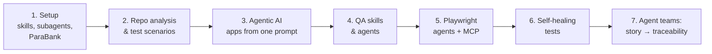

# Claude Code Learning Journal

**My notes from learning Claude Code as a QA engineer: from a first prompt to a five-agent team that turns a user story into executed tests and a traceability matrix.**

I'm a tester learning AI in public. Each lesson below has my notes, the prompts I used, and a link to what I built. Course slides aren't reproduced here; the notes and the work are mine.

## The path

## Lessons

| # | Lesson | What I built | Key idea |
|---|---|---|---|
| 1 | [Skills, Subagents & ParaBank Setup](lessons/01-skills-subagents-parabank-setup.md) | ParaBank running locally (JDK, Maven, Tomcat) | Skills are procedural knowledge; MCP is access to tools; subagents protect the context window |
| 2 | [App Analysis & Test Case Generation](lessons/02-app-analysis-test-case-generation.md) | [Architecture analysis](https://github.com/YOUR-USERNAME/agentic-qa-parabank/blob/main/docs/parabank-architecture.md) and [functional scenarios](https://github.com/YOUR-USERNAME/agentic-qa-parabank/blob/main/docs/functional-test-scenarios.md) | `CLAUDE.md` gives Claude the project context it can't infer |
| 3 | [Agentic AI: Build Apps with One Prompt](lessons/03-agentic-ai-build-apps-with-one-prompt.md) | [Kanban app](https://github.com/YOUR-USERNAME/one-prompt-apps), brand-voice skill, LinkedIn/X drafts | Plan mode, context control, and review agents that find real bugs |
| 4 | [QA Skills & Agents](lessons/04-qa-skills-and-agents.md) | `banking-qa-knowledge` skill, `qa-analyst-agent`, `/design-test` command | Skill = knowledge, agent = role, command = trigger; `$ARGUMENTS` makes them reusable |
| 5 | [Playwright Agents & MCP](lessons/05-playwright-agents-and-mcp.md) | Playwright MCP, planner/generator/healer agents, automation standards skill, `/generate-playwright-tests` | Without MCP, Claude guesses locators; with it, Claude reads the real DOM |
| 6 | [Self-Healing Tests](lessons/06-self-healing-tests.md) | Healer agent repairing failing tests | Fixes are found by comparing expected and live DOM, and each one is reported |
| 7 | [User Story to Traceability](lessons/07-user-story-to-traceability.md) | [Five-agent team + Excel traceability](https://github.com/YOUR-USERNAME/agentic-qa-parabank) | Agent teams for work with hand-offs; strict file ownership so agents don't collide |

## What I'd tell another tester starting out

1. **Start with `CLAUDE.md`.** Most bad output comes from Claude not knowing your project's rules.
2. **Turn your QA knowledge into a skill.** My banking risk checklist changed the test cases from generic to risk-ranked.
3. **Don't trust generated locators without MCP.** Connect the browser and let the agent see the page.
4. **Verify the verifier.** Review agents and healer agents are fast, but I still read every fix.
5. **Agent teams cost tokens.** Spawn each teammate only when its input is ready.

## Projects

- **[agentic-qa-parabank](https://github.com/YOUR-USERNAME/agentic-qa-parabank):** the main project. 9 agents, 3 skills, 2 commands; 49 test cases, 47 automated, 14 real defects found.
- **[one-prompt-apps](https://github.com/YOUR-USERNAME/one-prompt-apps):** the Kanban app built from one prompt, with a live demo.
