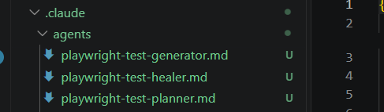

# Playwright AI Agents & Playwright MCP

To start automating test cases, give following prompt to claude:
```text
Generate a Playwright automation test for the Transfer Funds feature in ParaBank.
The application is at http://localhost:8080/parabank
username: ficusroot2
password: test@123
```

You will see it guesses locators. Those are not actual locators and they will fail if you try to run the code. As it does not know actual DOM structure.

That’s why we need MCP. Now we will install Playwright and MCP.

npm init playwright@latest

claude mcp add playwright npx @playwright/mcp@latest (for this we need to install claude cli)

Now an mcp.json will be installed

Start/stop server from there

Give following prompt:
```text
1. Use the browser to http://localhost:8080/parabank/
2. Log in with username: ficusroot2, password: test@123
3. Navigate to the Transfer Funds page
4. Describe the full DOM structure of the Transfer Funds form.
```

Now we need to install Playwright agents: Planner, Generator, Healer pipeline

npx playwright init-agents --loop=claude



Now we will create a skill for telling industrial standards to keep in mind while creating automation through playwright mcp and claude code

Now we have 4 agents and 2 skils so we will create a common agent which will do e2e automation by using required agents or skills or combinations as per requirement

Now to invoke this file to easily invoke it, we will create a slash command file inside commands folder – generate-playwright-tests.md

Command is a good way to invoke the required agent

Here we will be passing feature name as argument

Now give this command: /generate-playwright-tests transfer funds in claude code window
